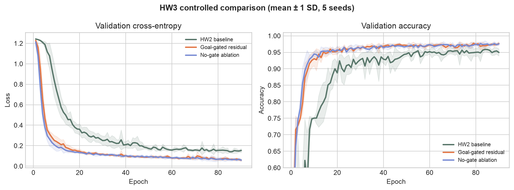
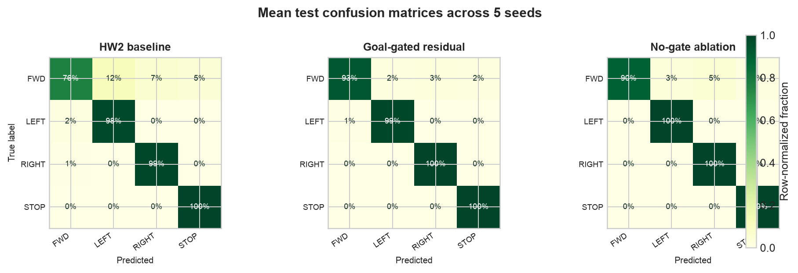

# Habitat Navigation Learner — HW3

An interactive trajectory viewer, annotation tool, and neural-network design experiment for embodied spatial intelligence. The prediction task is:

```text
Input:  current Habitat RGB image + relative goal distance + relative goal angle
Output: MOVE_FORWARD | TURN_LEFT | TURN_RIGHT | STOP
```

**Live demo:** [locus-campus-spatial-viewer.ryannchenoo.chatgpt.site](https://locus-campus-spatial-viewer.ryannchenoo.chatgpt.site)

## Task and dataset

Each RGB observation is resized to 8 × 8 pixels and flattened to 192 normalized values. Goal distance is divided by 10 and relative goal angle by π, giving 194 total baseline inputs.

The RGB observations are 30 frames sampled from the official public [Habitat-Lab](https://github.com/facebookresearch/habitat-lab) PointNav visualization [`skokloster-castle.glb_3662.gif`](https://github.com/facebookresearch/habitat-lab/blob/main/docs/images/habitat-lab-tdmap-viz-images/skokloster-castle.glb_3662.gif). `training/generate_data.py` constructs 120 **emulated PointNav episodes** (2,880 samples) around these public frames. Goal values and expert action labels are deterministic synthetic metadata, not ground truth recovered from Habitat.

Episodes—not individual frames—are split into 2,016 training, 432 validation, and 432 test samples. The fixed sample table is `data/navigation_samples.csv`.

## Baseline limitation

The HW2 baseline concatenates 192 image values and only two goal values immediately:

```text
[RGB192, goal2] → Linear(194,64) → ReLU → Linear(64,32) → ReLU → 4 logits
```

This early fusion treats heterogeneous modalities identically. The high-dimensional image can dominate two compact but decision-critical goal features, and there is no direct path that preserves a visual representation while goal context modifies it.

## Proposed design: goal-conditioned gated residual fusion

The new model encodes image and goal separately. It learns a bounded residual correction from both branches and uses goal features to control a 64-dimensional gate:

```text
v = ReLU(Wv · RGB)                         visual branch: 192 → 64
g = ReLU(Wg · goal)                        goal branch:       2 → 16
c = tanh(Wc · [v, g])                      correction:       80 → 64
z = v + sigmoid(Wgate · g) ⊙ c             gated residual fusion
logits = W2 · ReLU(W1 · z)                 classifier:       64 → 32 → 4
```

**Hypothesis.** Separate encoders should make the goal information harder to ignore, while the skip path preserves visual context. A learned gate should suppress unhelpful corrections and selectively apply useful ones.

**Possible failure.** Sigmoid gates can saturate, reducing their responsiveness or gradient flow. Extra parameters may also overfit this small synthetic dataset.

## Controlled experiments

Three models were trained with the same data, episode split, preprocessing, 90-epoch budget, batch size 128, Adam optimizer, learning rate 0.0025, and cross-entropy loss. Results report mean ± sample standard deviation over seeds 7400–7404.

| Model | Parameters | Test accuracy | Macro F1 | Test loss | Single-sample latency |
| --- | ---: | ---: | ---: | ---: | ---: |
| HW2 baseline | 14,692 | 95.60 ± 1.25% | 93.72 ± 2.01% | 0.1063 ± 0.0148 | 0.018 ms |
| **Goal-gated residual** | 20,884 | **98.70 ± 0.56%** | **98.27 ± 0.77%** | **0.0325 ± 0.0048** | 0.051 ms |
| No-gate residual ablation | 19,796 | 98.38 ± 0.33% | 97.85 ± 0.52% | 0.0406 ± 0.0109 | 0.036 ms |





## What happened and what I learned

The full design improved mean test accuracy by **3.10 percentage points** over HW2 and reduced run-to-run variation. Its largest class-level gain was `MOVE_FORWARD`, from 76.3% to 93.0% mean accuracy. This supports the idea that explicit modality handling helps the model resolve the narrow goal-angle region used for forward motion.

However, the ablation reached 98.38%, only 0.32 points below the full model. Therefore, the experiment does **not** show that gating alone explains the improvement. Separate encoders and residual fusion captured most of the gain. The gate mean was 0.853 and 52.1% of gate activations were below 0.1 or above 0.9; in practice, it often behaved like an almost-open switch. This is a useful partial failure of the original mechanism-level hypothesis.

The proposed model also has 42% more parameters and approximately 2.8× the measured single-sample CPU latency of the baseline. A stronger next experiment would add a parameter-matched two-branch control and an entropy or temperature constraint that discourages early gate saturation.

## Run the experiments

Python 3.10+ is recommended.

```bash
python -m venv .venv
source .venv/bin/activate
pip install -r training/requirements.txt
python training/generate_data.py
python training/train.py
python training/run_hw3_experiments.py
```

The HW3 script writes:

- `model/hw3_results.json` — per-seed histories, metrics, confusion matrices, and aggregate results
- `model/hw3_*.pt` — best-validation checkpoint for each architecture
- `public/model/hw3_summary.json` — compact browser-readable aggregate results
- `public/model/hw3_training_curves.png` — validation curves across seeds
- `public/model/hw3_confusion_matrices.png` — mean row-normalized confusion matrices
- `public/model/hw3_accuracy_comparison.png` — accuracy comparison with error bars

## Run the web application

Requires Node.js 22.13 or newer.

```bash
npm install
npm run dev
```

The web application runs the original HW2 MLP directly in the browser, supports frame/trajectory annotation, and presents the complete HW3 architecture, hypothesis, controlled results, and failure analysis. Create a production build with `npm run build`.

## AI-assisted development disclosure

OpenAI Codex assisted with implementation, experiment automation, visualization, web integration, and documentation. The data provenance, design hypothesis, architecture equations, controlled settings, raw per-seed outcomes, ablation, and limitations are documented so the work can be independently reviewed and explained. The student should understand and be able to defend the design and analysis.

