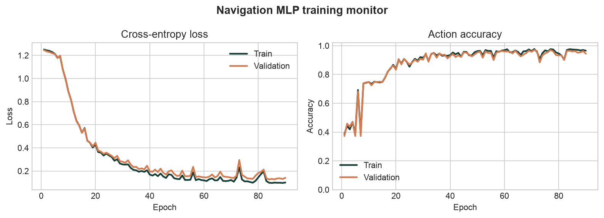

# Habitat Navigation Learner

An interactive trajectory viewer, annotation tool, and neural-network demo for embodied spatial-intelligence research. The HW2 model predicts the agent's **next navigation action** from a selected RGB observation plus relative goal distance and angle.

**Live demo:** [locus-campus-spatial-viewer.ryannchenoo.chatgpt.site](https://locus-campus-spatial-viewer.ryannchenoo.chatgpt.site)

## Prediction task

```text
Input:  current RGB image + goal distance + relative goal angle
Output: MOVE_FORWARD | TURN_LEFT | TURN_RIGHT | STOP
```

The image is resized to 8 x 8 RGB values (192 inputs). Normalized distance and angle add two more inputs. A small feed-forward MLP computes four action logits:

```text
194 inputs -> Linear(194, 64) -> ReLU
           -> Linear(64, 32)  -> ReLU
           -> Linear(32, 4)
```

The browser loads the exported trained weights, performs exactly the same preprocessing, runs the forward pass, applies softmax, and displays the predicted action, confidence, and all four probabilities. No Python process or notebook is needed at inference time.

## Data

The RGB observations are 30 frames sampled from the official public [Habitat-Lab](https://github.com/facebookresearch/habitat-lab) PointNav visualization [`skokloster-castle.glb_3662.gif`](https://github.com/facebookresearch/habitat-lab/blob/main/docs/images/habitat-lab-tdmap-viz-images/skokloster-castle.glb_3662.gif). The source visualization also provides synchronized depth and top-down-map views used by the viewer.

For HW2, `training/generate_data.py` builds 120 **emulated PointNav episodes** (2,880 samples) around those public RGB frames. Goal distances, relative angles, and expert action labels are generated by a documented deterministic policy. They are educational synthetic metadata and are not claimed to be ground truth recovered from Habitat. Homework 2 explicitly permits publicly available and emulated/synthetically generated data.

Episodes—not individual frames—are split into:

- Training: 2,016 samples (70%)
- Validation: 432 samples (15%)
- Test: 432 samples (15%)

The full generated sample table is in `data/navigation_samples.csv`.

## Training and performance

`training/train.py` demonstrates parameter initialization, forward propagation, cross-entropy loss, automatic differentiation/backpropagation, gradient calculation, and parameter updates with Adam. It trains for 90 epochs and writes both PyTorch and browser-ready weights.

| Model | Hidden layers | Test accuracy | Test loss |
| --- | ---: | ---: | ---: |
| Navigation MLP | 2 | **95.4%** | **0.0994** |
| Linear classifier baseline | 0 | 82.2% | 0.6931 |



Saved artifacts:

- `model/navigation_mlp.pt` - PyTorch weights and metrics
- `public/model/navigation_mlp.json` - browser inference weights
- `model/metrics.json` - final metrics
- `model/training_history.json` - per-epoch loss and accuracy
- `public/model/training_curves.png` - training monitor plot

## Web application features

- Select any trajectory frame and edit goal distance/angle
- Run the trained MLP directly from the graphical interface
- Display the next action, confidence, and class probabilities
- Display training/validation curves, test accuracy, and the linear baseline
- Browse synchronized RGB, depth, and top-down-map observations
- Navigate a long trajectory through overview, filmstrip, action, and event tracks
- Create frame-level point/bounding-box annotations
- Create trajectory interval annotations
- Import and export annotations as JSON

Annotation is implemented. A backend and database are not used: annotations are session-local with explicit JSON persistence, and model inference runs in the browser.

## Run the web application

Requires Node.js 22.13 or newer.

```bash
npm install
npm run dev
```

Then open the local URL printed by Vinext. Create a production build with:

```bash
npm run build
```

## Reproduce training

Python 3.10+ is recommended.

```bash
python -m venv .venv
source .venv/bin/activate
pip install -r training/requirements.txt
python training/generate_data.py
python training/train.py
```

The scripts use seed `7400` for reproducibility.

## Major libraries and frameworks

- PyTorch for the MLP, loss, backpropagation, and optimization
- NumPy, Pillow, and Matplotlib for data processing and plots
- React 19, TypeScript, Vinext, and Vite for the web application
- shadcn UI primitives and Lucide icons for interface components

## AI-assisted development disclosure

OpenAI Codex was used to help design the educational data pipeline, implement and debug the PyTorch training code, export the trained model for browser inference, integrate the model into the React interface, and edit this README. The task definition, data provenance, architecture, preprocessing, loss, optimizer, evaluation split, baseline comparison, and inference path are documented here so the implementation can be reviewed and explained independently.
